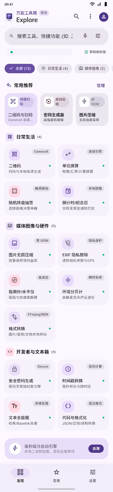
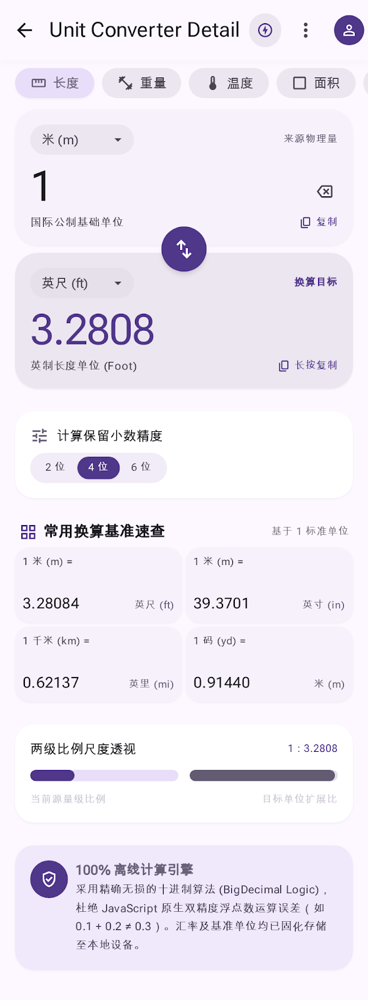
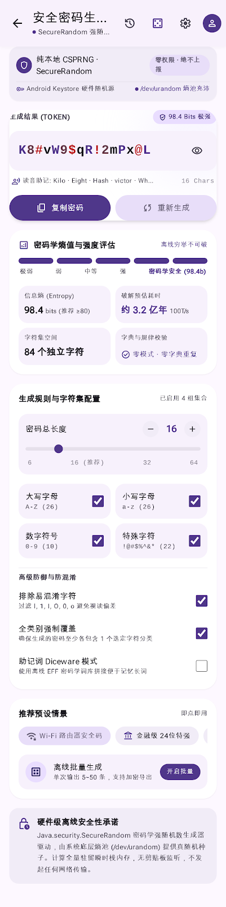
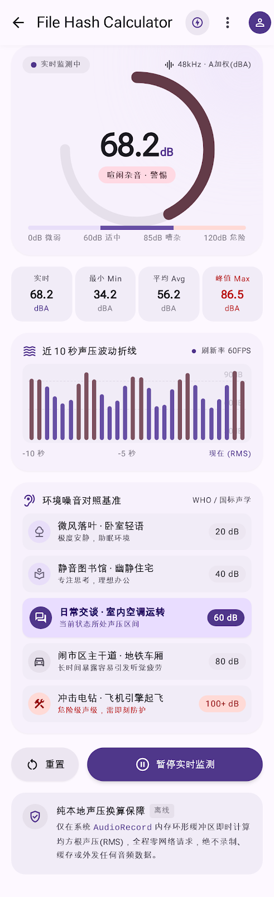

# OmniBox — 离线优先的 Android 工具箱


**15 款真实可用的本地工具**，Kotlin 2.0 + Jetpack Compose + Material 3 原生实现，不是网页、不是套壳、不是演示壳。

界面按 [`stitch_/stitch_/`](stitch_/stitch_/) 的 33 屏设计基线还原，仅把设计稿中的演示数值替换为真实数据；每个数值、开关、按钮都对应真实实现，未实现的能力会明确标注状态，**不做假交互、不显示编造的读数**。完整需求见 [`OmniBox-Android开发计划.md`](OmniBox-Android开发计划.md)。

> [!IMPORTANT]
> 本仓库的根目录是整个工作区，**Android 工程位于 [`OmniBox/`](OmniBox/) 子目录**（Gradle 根）。
> CI workflow 必须放在仓库根的 [`.github/workflows/android-build.yml`](.github/workflows/android-build.yml) 才会被 GitHub Actions 识别，它通过 `defaults.run.working-directory: OmniBox` 切到工程目录执行 Gradle。

## 界面预览

> 以下为设计基线的静态截图（Google Stitch 导出），用于说明视觉目标，**不是实机截图**；实际界面由 Compose 实现。

| 首页 | 单位换算 | 密码生成 | 环境分贝计 |
|:---:|:---:|:---:|:---:|
|  |  |  |  |

## 15 款工具

| 分类 | 工具 | 真实实现要点 | 权限 |
|---|---|---|---|
| 效率与文本 | 安全密码生成 | `SecureRandom`、熵值与破解耗时估算、字典校验、Diceware、批量生成 | 无 |
| 效率与文本 | 时间戳转换 | `java.time` 秒/毫秒双向、5 时区、ISO/周序数、时间差 | 无 |
| 效率与文本 | 文本全能箱 | MD5/SHA、Base64、URL 编解码、7 种清洗、字符统计 | 无 |
| 效率与文本 | 代码与格式化（开发者箱） | JSON 美化校验、进制联动、正则匹配与捕获组、URL 参数拆解 | 无 |
| 效率与文本 | 单位换算 | `BigDecimal` 七类物理量、温度 offset、精度档位 | 无 |
| 图像与媒体 | 二维码 | CameraX + ZXing 实时扫码、多格式生成（L/M/Q/H、尺寸、配色、留白）、相册解析、Room 历史 | `CAMERA`（可降级） |
| 图像与媒体 | 图片压缩 | 三段式防 OOM 采样、质量/最大边长/格式三轴、前后分割对比、SAF 导出 | 无（系统选择器） |
| 图像与媒体 | EXIF 隐私擦除 | 逐 tag 读取 → 风险分级 → **重编码擦除** → 回读验证差异 | 无（系统选择器） |
| 图像与媒体 | 格式转换 | PNG/JPEG/WEBP 真实批量转码、逐张真实进度、前台服务通知与取消、Room 任务记录 | 无（系统选择器） |
| 传感器与硬件 | 指南针 / 水平仪 | 加速度 + 磁场旋转矩阵、低通滤波、Canvas 罗盘、真北可选校正 | 定位（仅真北校正，可选） |
| 传感器与硬件 | 环境分贝计 | `AudioRecord` PCM → RMS → dBFS → 校准 SPL，瞬时/滑动平均/Leq/峰值 + WHO 对照 | `RECORD_AUDIO` |
| 传感器与硬件 | 屏幕检测 | 读 DisplayManager 的刷新率/HDR/广色域/亮度；纯色、256 阶灰阶、棋盘、多指四种全屏测试 + 触控沙盒 | 无 |
| 传感器与硬件 | 电池监控 | BatteryManager + sysfs 采集，1Hz 环形缓冲 900 点画 15 分钟功率波形，CSV 导出真实采样；充电目标/高温/充满本地提醒 | 通知（提醒开关） |
| 时间与随机 | 倒计时 / 纪念日 | Room 事件 CRUD、年度重复取下一周年、`AlarmManager` 真提醒、开机重建、Glance 小组件 | `POST_NOTIFICATIONS`（13+） |
| 时间与随机 | 随机转盘抽签 | `SecureRandom` 加权抽样、Canvas 扇区与旋转动画、Room 预设与选项增删改 | 无 |

### 探索 · 精选导航（第 4 个 Tab）

30 个真实站点 / 10 个分类，支持本地即时搜索、分类筛选（计数由注册表实时计算）、收藏与自建站点、Chrome Custom Tabs 打开、无痕沙盒、站点图标拉取与字母头像降级、断网提示。

刻意与设计稿保持差异：设计稿中的盗版影视站与影子图书馆入口未接入，替换为同分类的合规站点；标签只写可核验属性；「无痕」只承诺本机不留痕，不谎称能控制浏览器侧行为。

## 工程特性

- **离线优先，网络边界可验证**：只有探索页使用 `INTERNET`（外链、站点图标）与 `ACCESS_NETWORK_STATE`（离线提示），且两项权限**只允许 `:app` 声明**。门禁任务 `:verifyNetworkPolicy` / `:app:assertNetworkPolicy` 会拦截任何 feature/core 模块私自声明网络权限。15 款工具本体全部是纯本地运算，App 不内置 WebView、不代理内容。
- **注册表驱动，杜绝「界面写 15 款、实际只有 12 款」**：15 条 `ToolDefinition` 由各 feature 模块用 Hilt `@IntoSet` 贡献，首页、常用、搜索、设置的计数与列表统一由 `ToolCatalog` 生成。
- **MVI**：`StateFlow<UiState>` + `sealed UiEvent`，ViewModel 不把异常抛到 UI。
- **权限降级是真实分支**：相机、麦克风、定位、通知、精确闹钟被拒绝后走设计稿降级页或明确提示，不显示假数值；硬件特性全部 `required="false"`。
- **隐私**：`allowBackup=false` + 全量排除备份规则；密码本体、音频字节、相机帧不落盘；历史只记元信息。
- **系统能力**：转码 `dataSync` 前台服务、倒计时与二维码两个 Glance 小组件、开机重建提醒、edge-to-edge 系统栏适配、`omnibox://tool/{tool_id}` 深链直达工具页。
- **边缘到边缘**：21 处根容器消费 WindowInsets，状态栏图标明暗跟随 App 主题，避免顶栏压状态栏、底栏被手势条遮挡。

## 快速开始

### 方式 A：GitHub Actions 云构建（推荐，零本机 Android SDK）

推送到 `main`/`master` 或发起 PR 即自动构建 debug APK；也可在 Actions 页手动触发。runner 自动安装 JDK 17、Platform 35、Build-Tools 35.0.0。

| 触发方式 | 产物工件 |
|---|---|
| `push` / `pull_request` / 默认 `workflow_dispatch` | `omnibox-debug-apk`（自动 debug 签名，可直接 `adb install`） |
| 勾选 `build_release` | 上述 + 签名 release APK（`omnibox-release`） |
| 勾选 `build_aab` | 上述 + AAB |

**默认 debug 包不需要任何 Secrets。** 首次使用：建好 GitHub 远程仓库并 `git push` → Actions → **OmniBox Android Build** → Run workflow → 下载工件解压后 `adb install app-debug.apk`。

签名 release 包需先在 `Settings → Secrets and variables → Actions` 配置 **4 项**（`OMNIBOX_KS_B64`、`OMNIBOX_KS_PASS`、`OMNIBOX_KEY_ALIAS`、`OMNIBOX_KEY_PASS`）；第 5 个变量 `OMNIBOX_KS_PATH` 由 workflow 解码 keystore 后自动写入，无需手工添加。keystore 与口令均被 `.gitignore` 排除，**绝不入库**。

CI 内固化的门禁：工程静态自检、JVM 单测、两道网络权限门禁、合并后 Manifest 的 `INTERNET` 复核、`apksigner` 签名校验与 SHA-256 留档；失败时上传构建报告。

### 方式 B：本地构建

| 项 | 要求 |
|---|---|
| JDK | **17**（Gradle 8.9 不支持 JDK 25 运行 daemon） |
| Android SDK | Platform 35 + Build-Tools 35.0.0 |
| Gradle | 8.9，wrapper jar 已随工程入库 |
| 版本 | Kotlin 2.0.21 · AGP 8.7.3 · Compose BOM 2024.12.01 · Hilt 2.51.1 · Room 2.6.1 |

```bash
cd OmniBox
python scripts/check-env.py       # 环境自检：JDK / SDK / wrapper
python scripts/check-project.py   # 工程静态自检（不需要 JDK/SDK）
./gradlew :app:assembleDebug      # → app/build/outputs/apk/debug/app-debug.apk
./gradlew test                    # 引擎层 JVM 单测
```

Windows 用 `gradlew.bat`。工程位于中文路径时已在 `gradle.properties` 放行 `android.overridePathCheck=true`。release 签名、`bundleRelease`、发布前校验与 CI 细节见 [`OmniBox/BUILD.md`](OmniBox/BUILD.md)。

> 未配置签名时 `assembleRelease` 只会产出 `app-release-unsigned.apk`（无法安装）；要可安装的包请用 `assembleDebug`，或在 CI 配好 Secrets 后勾选 `build_release`。

## 仓库结构

```
软件开发/                         ← Git 仓库根（GitHub 首页读这里的 README.md）
├── README.md                     本文件
├── .github/workflows/             Android Build CI（根级才会被 GitHub 识别）
├── OmniBox/                       Android 工程（Gradle 根）
│   ├── app/                       Application、导航、Glance 小组件、签名与混淆
│   ├── core/                      designsystem / common / model / data（ToolCatalog、Room、DataStore）
│   ├── feature/                   16 个模块：14 个工具模块 + home + explore
│   ├── scripts/                   环境自检、工程自检、文案覆盖比对、发布前校验
│   └── BUILD.md 等                构建签名、实现进度、设计覆盖率报告
├── OmniBox-Android开发计划.md      完整开发计划与排期
├── stitch_/stitch_/               33 屏设计基线（code.html + 32 张 screen.png）
├── stitch_text_extract.txt        设计稿文案提取结果
└── SDK/                          本地 Android SDK 副本（约 587 MB，已忽略，不入库）
```

## 验证状态（2026-11-10）

| 项 | 结果 |
|---|---|
| `assembleDebug` | ✅ 0 错误 0 警告，debug APK 约 23.8 MB，`adb install` 可直装 |
| `assembleRelease` / `bundleRelease` | ✅ R8 + 资源压缩，release APK 约 5.1 MB、AAB 约 8.8 MB，RSA 4096 签名 |
| `test` | ✅ **165 条** JVM 单测，debug/release 两变体全绿 |
| `check-project.py` | ✅ 0 错误 0 警告，15 条工具注册齐全 |
| `verify-release.sh` | ✅ 签名 v1/v2/v3、网络权限策略、合并 Manifest 复核、SHA-256 留档 |
| `check-screens.py` | ⚠️ 32 屏 / 1354 条设计文案 / 命中 835（**61.7%**） |

关于 61.7%：该脚本比对的是**中文文案存在性**，不是像素级视觉还原，也不评价功能完成度；未命中的主要是设计稿中的营销式说明长句（实现里刻意不把宣传语搬进 App），短标签类文案基本全中。探索页是后期追加需求，不在这 32 屏统计口径内。口径与逐屏明细见 [`OmniBox/SCREEN_COVERAGE.md`](OmniBox/SCREEN_COVERAGE.md)。

**尚未验证**：本机无模拟器/系统镜像，未做真机逐屏视觉比对与传感器数据实测；云端 CI 也尚未首次实跑（远程仓库待建立）。

## 已知取舍

- 音视频转码未引入 FFmpeg-Kit（体积 +40~70 MB、含 native 库），位图转码是真实实现，界面不提供假按钮。
- 语音输入未实现：入口存在但不弹假结果，本地语音识别需额外模型与依赖。
- Roboto Flex 变量字体未随设计包提供，暂用 `FontFamily.Default`，字阶按设计规范落地；Material Symbols 为语义近似映射。
- EXIF 擦除采用「解码 → 重编码输出新文件 → 回读验证」，代价是 JPEG 二次压缩的轻微画质损失，换取彻底清除且不破坏原图。
- Room `exportSchema = false`，正式版本迁移前需开启并配置 schema 归档。
- `keystore/omnibox-release.jks` 为本机自建密钥，上架前必须替换为自己的密钥并离线备份；丢失后无法向已安装用户发布更新。
- 仓库暂未附加 `LICENSE`，默认保留所有权利；如需开源请先补充许可证文件。

逐项细节与偏差记录在 [`OmniBox/IMPLEMENTATION_STATUS.md`](OmniBox/IMPLEMENTATION_STATUS.md)。

## 文档索引

| 文档 | 内容 |
|---|---|
| [`OmniBox/README.md`](OmniBox/README.md) | 工程视角的目录、架构与构建状态 |
| [`OmniBox/BUILD.md`](OmniBox/BUILD.md) | 环境、签名、发布、CI 与本机 SDK 安装记录 |
| [`OmniBox/IMPLEMENTATION_STATUS.md`](OmniBox/IMPLEMENTATION_STATUS.md) | 里程碑、13→15 款工具、权限降级矩阵、已知偏差 |
| [`OmniBox/SCREEN_COVERAGE.md`](OmniBox/SCREEN_COVERAGE.md) | 32 屏文案覆盖率报告（脚本生成） |
| [`OmniBox-Android开发计划.md`](OmniBox-Android开发计划.md) | 完整开发计划与验收口径 |
| [`stitch_/stitch_/`](stitch_/stitch_/) | 33 屏静态设计基线 |
| [`stitch_text_extract.txt`](stitch_text_extract.txt) | 设计稿中文文案提取 |
